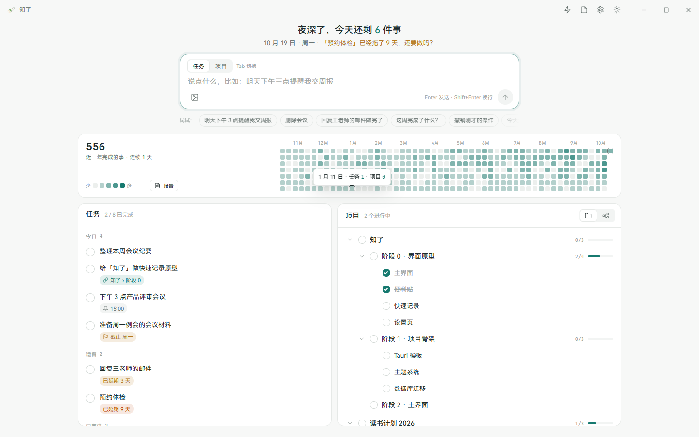

<div align="center">
  

# 知了 Cicada

**你只管说，它来整理。**

一个安静地待在 Windows 桌面的个人任务与项目助手。<br>
用自然语言记事、安排任务、推进项目和回顾完成情况，不必反复打开表单整理字段。

[](CHANGELOG.md)
[](#下载与使用)
[](https://tauri.app/)
[](LICENSE)

[下载](#下载与使用) · [快速开始](#三步开始使用) · [产品设计](docs/产品设计.md) · [隐私说明](PRIVACY.md) · [参与开发](CONTRIBUTING.md)
</div>



<p align="center"><sub>主界面预览，内容为示例数据。</sub></p>

## 它解决什么问题

普通待办工具往往要求你先想清楚该点哪里、填哪些字段、放进哪个列表。知了把这些整理工作交给模型：你说出要做的事，它通过受约束的工具调用把内容落到任务、项目、提醒或重复计划中。

| 你可以这样说                                 | 知了会做什么               |
| -------------------------------------------- | -------------------------- |
| “明天下午三点提醒我交周报”                   | 创建明日任务并设置提醒     |
| “每周一提醒我整理本周安排”                   | 创建重复任务               |
| “建一个发布官网的项目，分成设计、开发和上线” | 建立最多三层的项目结构     |
| “把官网项目里的部署安排到今天”               | 创建今日任务并关联项目节点 |
| “这周完成了什么？”                           | 根据本机完成记录生成总结   |
| “撤销刚才的操作”                             | 回退最近一组用户操作       |

## 为什么是知了

### 只说不点

除了勾选今日任务，任务和项目的新增、修改、查询、移动与删除都从同一个输入框发起。按 `Ctrl+Tab` 切换任务和项目模式，空输入框按 `Tab` 可采用当前示例，确认内容后再发送。

可以直接粘贴 Markdown 列表；原文保存在本机。近 24 小时最近 6 轮对话共享上下文，继续说“把刚才那个改到明天”即可关联前文；真正修改前仍会查询当前数据。

### 随时记下

按 `Ctrl+Alt+Space` 可从任何软件唤起快速记录。便利贴可以常驻桌面，主窗口关闭后留在系统托盘，需要时再回来查看。

### 任务与项目不再分家

项目节点可以安排到今天，生成关联任务；完成任务时同步完成对应节点，并且只记一次完成记录。

### 自动留下回顾线索

完成热力图展示近一年的节奏，周报、月报和年报基于本机归档数据生成。提示词可查看、修改和恢复默认。

### 写入有边界，也能后悔

模型不能直接修改数据库，只能调用白名单工具；程序会再次校验日期、层级和对象状态。删除与批量修改先给出预览，用户确认后才执行；用户操作支持连续撤销。

### 数据由你保管

任务、项目、报告和设置保存在当前电脑。API Key 存入 Windows 凭据管理器，不写入配置文件、数据库、日志或备份。

## 下载与使用

知了 `0.2.4` 提供 **Windows 11 x64** 无需安装的直接运行 EXE。

从 [GitCode Releases](https://gitcode.com/HenonBamboo_YYJ/Cicada/releases) 或 [GitHub Releases](https://github.com/HenonBamboo/Cicada/releases) 下载 `Cicada-0.2.4-windows-x64.exe` 或便携 ZIP。两处发布同一源码标签和相同下载文件。

**从 0.2.2 及更早版本升级：** 0.2.3 起使用新的更新签名密钥，请先退出旧程序，手动下载新版覆盖原 EXE。数据和自定义提示词会保留；0.2.3 及后续版本支持应用内更新。

运行前请确认系统已安装 Microsoft Edge WebView2 Runtime。当前 EXE 没有 Windows 代码签名，首次启动时可能显示来源提示；请从上述 Releases 下载并核对同版本的 `SHA256SUMS`。应用内更新另有独立的签名校验。

### 三步开始使用

1. 下载并直接运行 EXE，或解压便携 ZIP 后运行其中的 `cicada.exe`。
2. 打开“设置 → 模型”，填写服务商、Base URL、模型名和 API Key。
3. 回到主界面，说一句要记录、查询或调整的事情。

Base URL 支持 HTTP 和 HTTPS。HTTP 会明文传输请求内容和 API Key，只应连接受信任的模型服务。

### 默认快捷键

| 操作                | 快捷键                              |
| ------------------- | ----------------------------------- |
| 快速记录            | `Ctrl+Alt+Space`                    |
| 显示 / 隐藏主窗口   | `Ctrl+Alt+Z`                        |
| 显示 / 隐藏便利贴   | `Ctrl+Alt+S`                        |
| 采用输入示例        | 空输入框按 `Tab`，填入后需发送      |
| 正向焦点导航        | `Shift+Tab`                         |
| 切换任务 / 项目模式 | `Ctrl+Tab`                          |
| 发送 / 换行         | `Enter` / `Shift+Enter`             |
| 浏览之前的输入      | `↑` / `↓`；多行内容仅在首尾边界生效 |

三个全局快捷键都可以在设置中修改。

## 数据与隐私

正式版数据目录为 `%APPDATA%\Cicada`，开发版使用独立目录 `%APPDATA%\Cicada-dev`。

```text
Cicada/
├── cicada.db       # 任务、项目、完成记录与操作日志
├── config.json     # 用户设置，不含 API Key
├── reports/        # 周报、月报和年报
├── prompts/        # 用户修改过的提示词
├── inbox/          # 待处理请求的临时图片
├── logs/           # 脱敏日志
└── backups/        # 本地备份
```

使用 AI 功能时，知了只向你选择的模型服务发送完成本次请求所需的文字、查询结果或图片，不会上传整个数据库。完整的数据范围、保留规则和凭据处理方式见[隐私说明](PRIVACY.md)。

程序每次启动后在后台检查一次 GitCode 新版，也可在“设置 → 关于”手动检查和更新，不进行定时检查。确认更新后，程序验证清单签名、文件大小和 SHA-256，再替换原路径 EXE 并重启；替换或启动失败时保留或恢复旧程序。也可以退出后手动覆盖 EXE。业务数据保存在独立目录，不会随 EXE 替换而删除；数据库升级前会备份。设置页保存的自定义提示词会保留，`prompts/defaults` 仅是随版本更新的参考稿。

请将 EXE 放在当前用户有写入权限的目录。

版本变化见[更新记录](CHANGELOG.md)，完整交互规则见[产品设计](docs/产品设计.md)。

## 从源码运行

### 环境要求

- Node.js 与 npm；
- Rust MSVC 工具链；
- Visual Studio C++ 构建工具与 Windows SDK；
- Microsoft Edge WebView2 Runtime。

### 启动开发版本

```powershell
git clone https://github.com/HenonBamboo/Cicada.git
cd Cicada
npm ci
npm run tauri dev
```

### 构建便携版本

```powershell
powershell -NoProfile -ExecutionPolicy Bypass -File scripts/package.ps1
```

脚本默认将五个发布文件写入独立系统临时目录，并输出其位置；可用 `-OutputDirectory` 指定空目录。正式打包需要仓库外的发布签名私钥；自行开发可直接运行 `npm run tauri -- build --no-bundle`，得到 `src-tauri/target/release/cicada.exe`。维护者遵循[发布流程](docs/发布流程.md)，确保二进制与对应源码标签一致。

### 项目结构

```text
src/                  # React 界面、窗口入口与前端状态
src-tauri/src/
├── commands/         # Tauri IPC 命令入口
├── service/          # 任务、项目、撤销等业务规则
├── agent/            # 模型工具调用与请求处理流程
├── llm/              # 模型服务协议适配
├── desktop/          # 窗口、托盘、快捷键和通知
├── scheduler/        # 日切、提醒、报告和后台处理
├── updater/          # GitCode 签名检查与便携 EXE 替换
└── db/               # SQLite 连接与迁移
docs/                 # 产品设计、视觉规范和交互原型
scripts/              # 发布打包脚本
```

## 参与开发

Issue 和 Pull Request 都欢迎。提交代码前请先阅读[贡献指南](CONTRIBUTING.md)。安全问题请按照[安全政策](SECURITY.md)私下报告，不要在公开 Issue 中附带 API Key、数据库或备份文件。

## 许可证

除单独标明的第三方组件外，本仓库的源代码、文档和项目自有图形资源依据 [GNU Affero General Public License v3.0 only](LICENSE) 发布。第三方组件仍适用各自许可证，详见 [THIRD_PARTY_NOTICES.txt](THIRD_PARTY_NOTICES.txt)。

Copyright © 2026 HenonBamboo.
